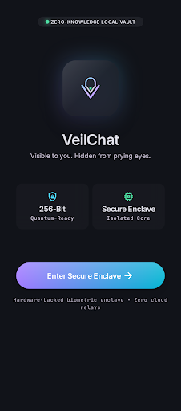
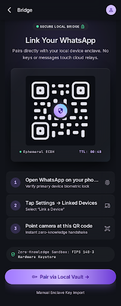
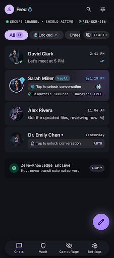
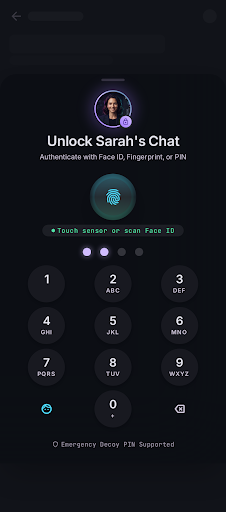
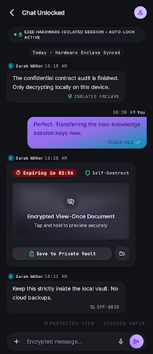
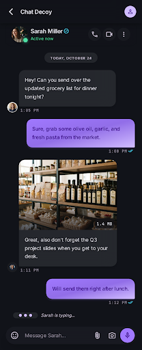
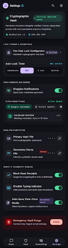
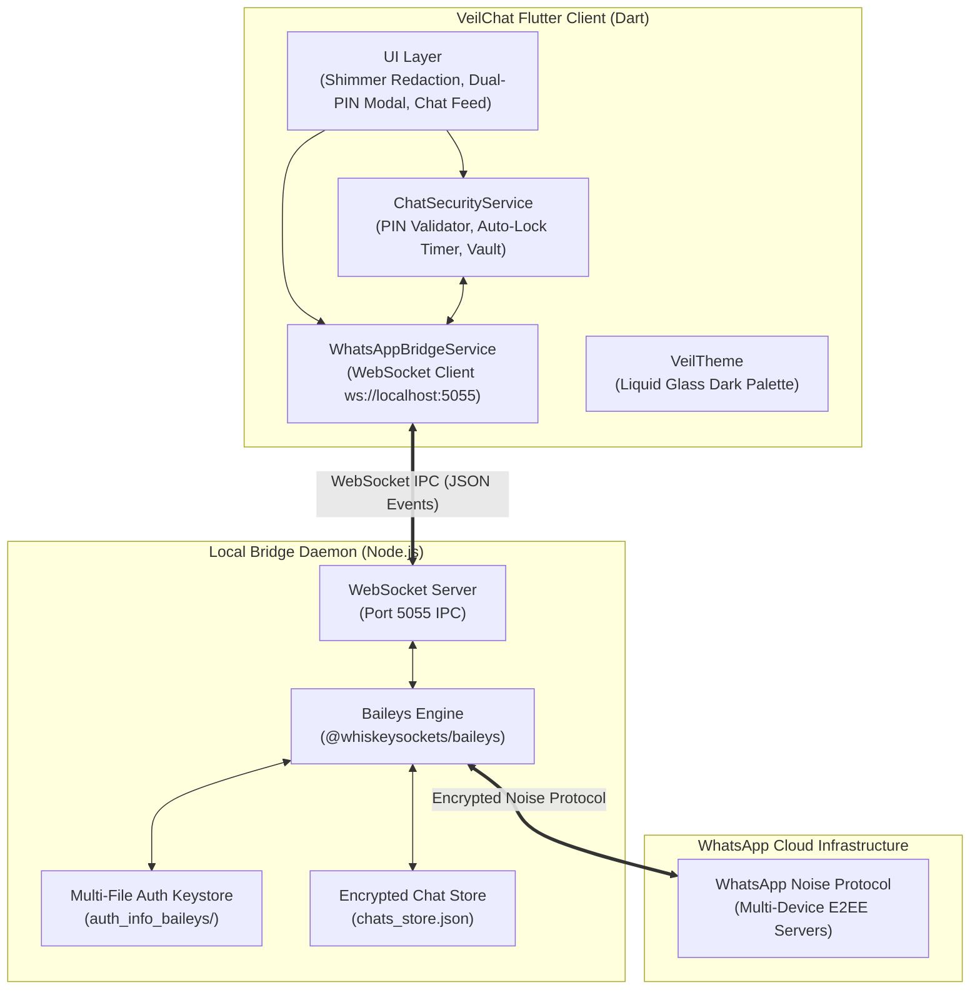

# 🛡️ VeilChat

<div align="center">


### *Zero-Leakage Privacy-First WhatsApp Client, Duress Cloaking Enclave & Stealth Suite*

[](https://flutter.dev)
[](https://dart.dev)
[](https://nodejs.org)
[](https://github.com/WhiskeySockets/Baileys)
[](#-security-architecture)
[](LICENSE)

<br/>

[Key Features](#-key-features) • [Screenshots](#-visual-showcase--screenshots) • [Architecture](#-architecture) • [Getting Started](#-getting-started) • [Default PINs](#-default-credentials--pins) • [Project Structure](#-project-structure)

</div>

---

## 📖 Overview

**VeilChat** is an advanced, privacy-hardened alternative client and security enclave for **WhatsApp**. Built with **Flutter** and powered by a local **Node.js Multi-Device Daemon** (`@whiskeysockets/baileys`), VeilChat addresses the vulnerabilities of standard messaging clients—such as shoulder-surfing, forensic exposure, coerced unlocks, and invasive telemetry.

With VeilChat, sensitive contacts are veiled behind **animated shimmer redaction masks**, incoming notifications are **camouflaged** as routine system alerts, and a **Dual-PIN Duress Architecture** provides believable deniability under coercion: unlocking with a decoy PIN displays a realistic, benign conversation with zero forensic residue of confidential data.

---

## 📸 Visual Showcase & Screenshots

### 1. App Launch & Multi-Device Pairing

| Screen 0: Splash & Brand Launch | Screen 1: WhatsApp Bridge & Pairing |
|:---:|:---:|
|  |  |
| *Liquid Glass branded launch with cryptographic key verification* | *Direct multi-device QR pairing over local WebSocket daemon with laser scan animation* |

---

### 2. Veiled Chat Feed & Biometric / PIN Unlock

| Screen 2: Unified Veiled Chat Feed | Screen 3: Biometric & Keypad Modal |
|:---:|:---:|
|  |  |
| *In-feed Shimmer Redaction disguises preview text and prevents shoulder-surfing* | *Secure biometric and dual-PIN keypad with tactile randomized response* |

---

### 3. Real Unlocked View vs. Decoy Duress Mode

| Screen 4: Real Unlocked Conversation | Screen 5: Decoy Mode (Coercion Protection) |
|:---:|:---:|
|  |  |
| *Confidential chat with live countdown radial timer, quick panic lock, and vault saver* | *Innocent dummy conversation displayed when entering the decoy PIN under duress* |

---

### 4. Privacy & Tactical Camouflage Settings

<div align="center">

| Screen 6: Privacy & Camouflage Settings |
|:---:|
|  |
| *Tactical Enclave status, Ghost Mode toggles, auto-lock timeouts, and stealth notification disguises* |

</div>

---

## ✨ Key Features

### 🎭 Dual-PIN Duress Architecture (Plausible Deniability)
- **Primary PIN (`1234`)**: Unlocks confidential conversations, encrypted media, and genuine chat history.
- **Decoy PIN (`9999`)**: If forced to unlock under physical coercion or inspection, the decoy PIN opens a harmless, pre-populated casual chat (e.g. lunch plans), showing no forensic indicator that another PIN exists or that confidential messages are hidden.
- **Biometric Authentication**: Fingerprint and Face ID support for rapid single-touch access.

### 🛡️ In-Feed Shimmer Redaction & Cloaking
- Sensitive conversations are cloaked directly in the chat feed with continuous **animated shimmering redaction bars**.
- Contact names and message previews remain protected from casual shoulder-surfers.
- Per-conversation lock toggles enable selective privacy for specific contacts.

### ⏱️ Radial Auto-Relock Timer & Panic Button
- **Configurable Auto-Lock**: Choose between **15s, 30s, 60s, or 120s** auto-lock timeouts.
- **Live Progress Ring**: A subtle radial progress indicator in the app bar counts down the remaining seconds of unlocked access.
- **Instant Panic Lock**: A dedicated top-bar lock button instantly scrubs unlocked memory and pops back to the redacted feed.
- **Lifecycle Auto-Lock**: Minimizing, backgrounding, or switching away from the app instantly re-locks all chats.

### 👻 Ghost Mode & WhatsApp Stealth Suite
- **Ghost Read Receipts**: Read incoming messages silently; senders only receive double grey ticks (no blue checkmarks).
- **Stealth Story / Status Viewer**: Inspect contacts' WhatsApp stories without appearing on their viewer list.
- **Concealed Presence**: Disables outbound "typing..." and "recording audio..." presence indicators.
- **View-Once Auto-Vault**: Intercepts ephemeral "View-Once" images and audio clips and saves them to an encrypted offline vault.
- **Anti-Revoke Message Keeper**: Retains inbound messages locally even if the sender executes "Delete for Everyone".

### 🔔 Stealth Notification Camouflage
- Incoming notification alerts from locked contacts are masked as innocuous system notices:
  - *Google Calendar: Team Sync in 15m*
  - *System Update: Synced successfully*
  - *News Alert: Markets close higher today*

### 🌉 Native Multi-Device Daemon
- Powered by a local Node.js daemon running `@whiskeysockets/baileys`.
- Direct communication using the WhatsApp Noise Protocol Framework over WebSocket (`ws://localhost:5055`).
- Does **not** require an open browser tab or an always-on phone connection once linked.

### 🎨 Liquid Glass & Tactical Enclave Design
- Cyberpunk-inspired dark aesthetic (`#111319` obsidian background).
- Cyber Cyan, Emerald Neon, and Primary Violet neon accents with frosted glassmorphic cards (`GlassCard`).

---

## 🏛️ Architecture



---

## 🚀 Getting Started

### Prerequisites

Ensure you have the following installed on your machine:
- [Flutter SDK](https://docs.flutter.dev/get-started/install) (v3.13 or newer)
- [Dart SDK](https://dart.dev/get-dart) (v3.0 or newer)
- [Node.js](https://nodejs.org/) (v18.x or v20.x LTS) & `npm`
- An active WhatsApp account on your mobile phone

---

### Step 1: Clone the Repository

```bash
git clone https://github.com/vasimsamtani/VeilChat.git
cd VeilChat
```

---

### Step 2: Start the WhatsApp Bridge Daemon

You can start the bridge using the bundled Windows script or manually via npm:

#### Option A: Quick Launch (Windows)
Double-click `start_bridge.bat` or run:
```cmd
start_bridge.bat
```

#### Option B: Terminal (Cross-Platform)
```bash
cd server
npm install
npm start
```

The bridge server will listen on `ws://localhost:5055` and output a terminal pairing QR code if no previous session exists.

---

### Step 3: Run the Flutter Client

Open a new terminal window at the root of the repository:

```bash
# Get Flutter dependencies
flutter pub get

# Launch on your preferred device (Windows, Android, iOS, macOS, Web)
flutter run
```

---

### Step 4: Link Your WhatsApp Account

1. In VeilChat, navigate to the **WhatsApp Bridge** screen (tap the QR scanner icon in the top bar).
2. Open **WhatsApp** on your mobile phone.
3. Go to **Settings** > **Linked Devices** > **Link a Device**.
4. Scan the animated QR code rendered on the VeilChat screen.
5. Your chats will synchronize with zero-knowledge local encryption!

---

## 🔑 Default Credentials & PINs

VeilChat comes pre-configured with the following default PINs (both can be changed inside **Privacy & Stealth Controls**):

| Mode | PIN | Purpose |
|:---|:---:|:---|
| **Primary Real PIN** | `1234` | Unlocks genuine confidential chats and vault |
| **Decoy / Duress PIN** | `9999` | Displays fake, harmless conversation during coerced access |

> [!TIP]
> You can customize both the **Primary PIN** and **Decoy PIN**, as well as the auto-lock duration (15s–120s), in **Settings > Privacy & Stealth Controls**.

---

## 📁 Project Structure

```
VeilChat/
├── assets/                     # App icons and graphical assets
├── lib/
│   ├── data/
│   │   ├── models/
│   │   │   └── chat_model.dart             # Chat and Message data models
│   │   └── services/
│   │       ├── chat_security_service.dart   # PIN auth, countdown timers, decoy logic
│   │       └── whatsapp_bridge_service.dart # WebSocket IPC communication with Baileys
│   ├── ui/
│   │   ├── core/
│   │   │   ├── theme.dart                   # Liquid Glass cyber theme & color tokens
│   │   │   └── widgets/
│   │   │       ├── glass_card.dart          # Frosted glass container widget
│   │   │       └── shimmer_redaction.dart   # Shimmer effect for redacted messages
│   │   └── features/
│   │       ├── auth/
│   │       │   └── security_keypad_modal.dart # Custom secure numeric keypad
│   │       ├── bridge/
│   │       │   └── bridge_screen.dart       # Laser QR scanner & device linking
│   │       ├── chat_list/
│   │       │   └── chat_list_screen.dart    # Redacted feed, filter tabs, ambient strip
│   │       ├── conversation/
│   │       │   └── conversation_screen.dart # Chat view, radial timer, decoy handler
│   │       ├── settings/
│   │       │   └── privacy_settings_screen.dart # Tactical Enclave, Ghost Mode, PINs
│   │       └── splash/
│   │           └── splash_screen.dart       # Animated brand launch screen
│   └── main.dart                            # Application lifecycle & Provider setup
├── server/
│   ├── auth_info_baileys/                   # Multi-device session credentials (git-ignored)
│   ├── bridge.js                            # WebSocket server + Baileys socket integration
│   ├── Dockerfile                           # Container definition for bridge daemon
│   └── package.json                         # Node.js dependencies (@whiskeysockets/baileys)
├── screenshots/                             # High-resolution screenshots for README
├── start_bridge.bat                         # Quick-start script for Windows
├── pubspec.yaml                             # Flutter dependencies & metadata
└── README.md                                # Repository documentation
```

---

## 🔒 Security & Privacy Philosophy

1. **Zero External Telemetry**: VeilChat sends zero diagnostic metrics, analytics, or crash reports to third-party servers.
2. **Local Keystore Enclave**: WhatsApp credentials remain strictly on your local machine in `server/auth_info_baileys/`.
3. **In-Memory Scrubbing**: Confidential decrypted chats exist only in temporary memory and are immediately scrubbed upon timeout or app backgrounding.
4. **Plausible Deniability**: The decoy subsystem is designed so that entering the decoy PIN does not generate alerts, delays, or indicators that an alternate state exists.

---

## 🤝 Contributing

Contributions, issues, and feature requests are welcome!

1. Fork the Project
2. Create your Feature Branch (`git checkout -b feature/AmazingFeature`)
3. Commit your Changes (`git commit -m 'Add some AmazingFeature'`)
4. Push to the Branch (`git push origin feature/AmazingFeature`)
5. Open a Pull Request

---

## 📄 License

Distributed under the **MIT License**. See `LICENSE` for more information.

---

<div align="center">
  <sub>Built with ❤️ for privacy advocates, security researchers, and stealth communicators.</sub>
</div>
